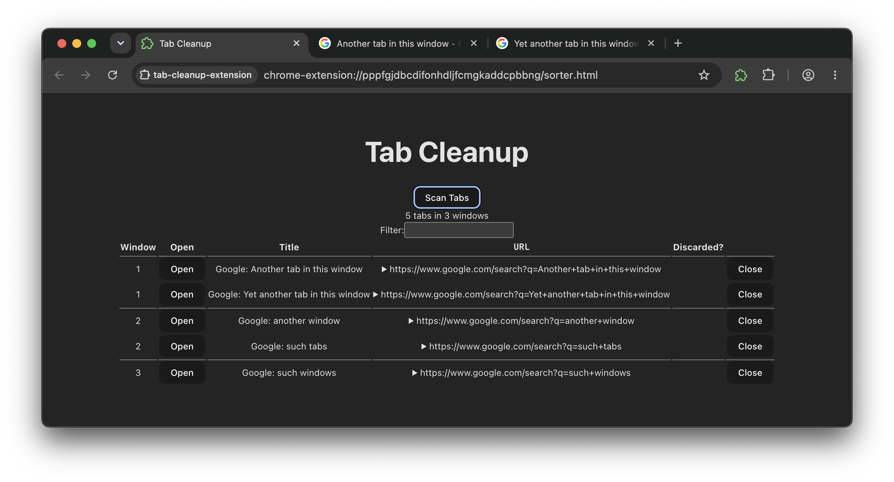

# Chrome Tab Clenaup Extension

If you have _way_ too many open browser tabs, this extension can help review & close them.

## Screenshots



## Why trust me?

I don't know, I'm just some guy with way too many open browser tabs.

Feel free to make your own version of this if you want. That's what I did.

## Development

Run in terminal:
```
pnpm ci
pnpm run dev
```

In Chrome's Extension Settings, enable Developer Mode and Load .output/chrome-mv3-dev as an unpacked extension.
